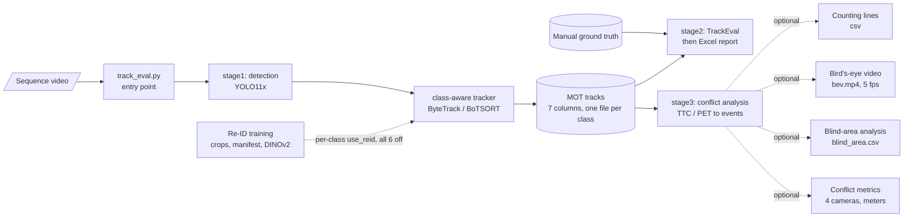
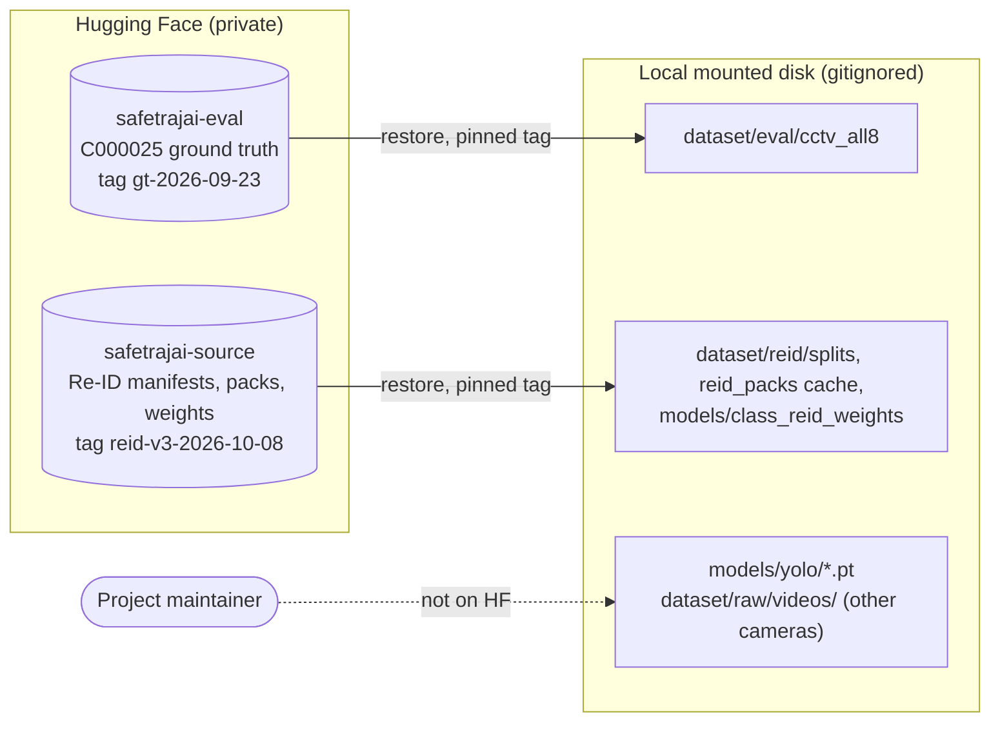
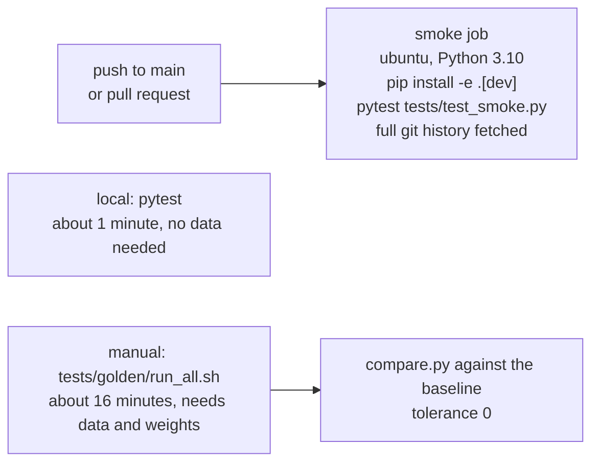
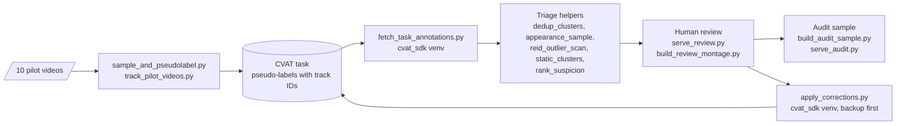
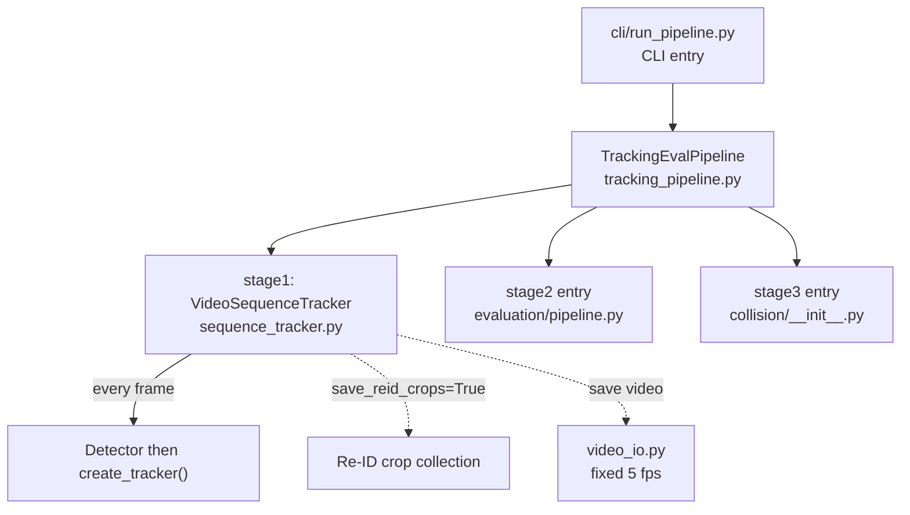
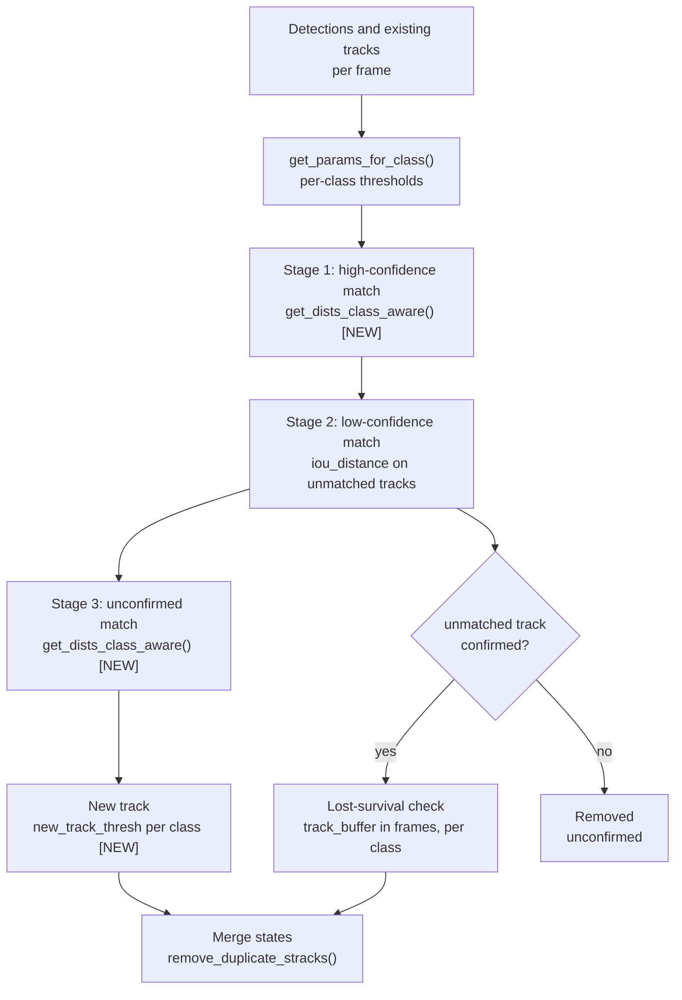
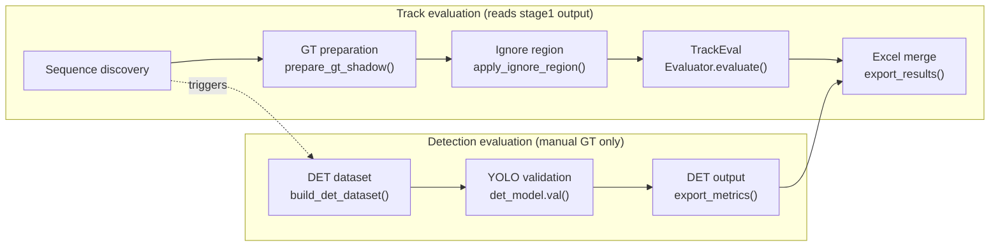
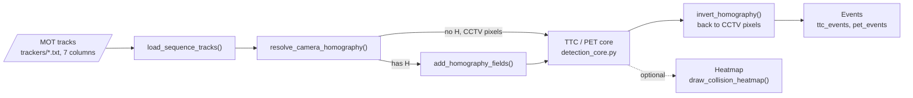
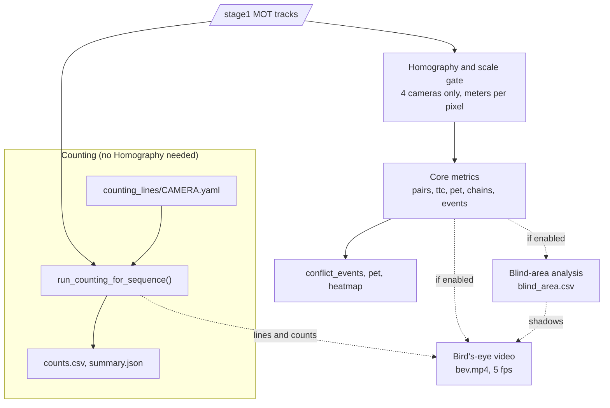
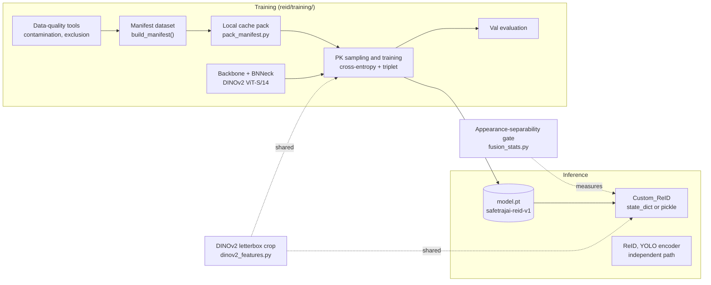

# safetrajai_eval

Offline CCTV traffic-monitoring pipeline: YOLO11 detection, class-aware BoTSORT / ByteTrack tracking, TrackEval evaluation (HOTA / CLEAR / Identity), and conflict-event analysis (TTC / PET with Homography), with Excel reports.

> **Status: runnable, but evaluated on a single camera (C000025). The pipeline (stage1 to stage3) and the test suite run in the conda env `track_eval`; the evaluation set is 6 sequences of 15 seconds from one camera, so every score below describes that camera only. Counting lines, the bird's-eye video and the blind-area analysis are optional stage3 outputs and are all disabled by default. Re-ID is trained locally (DINOv2 ViT-S/14, val mAP 0.783) but is switched off for all 6 classes: on the `botsort_reid_timm.yaml` baseline no class passed the tracking acceptance rule, and the appearance-separability improvement did not turn into fewer ID switches. The only positive Re-ID signal, a preliminary one for scooters on a different tracker baseline, is documented in [Results](#results) and not used. The conflict indicators (TTC, PET, DRAC and the others) are technical signals, not safety conclusions: only cameras with a passed scale check are converted to meters, and the metrics were not calibrated against field measurements. CI runs the smoke tests on every push; the golden regression comparison (about 16 minutes, needs the full data and weights) is a manual step and is not in CI. A detection-dataset refinement effort (pseudo-labels reviewed in a self-hosted CVAT) is in progress: person, small_truck, bus and truck are fully reviewed, car and scooter went through ranked review plus acceptance sampling with measured residual error rates (see [Known gaps](#known-gaps-to-reinforce)), the phase-2 measurement found many missed (unlabeled) objects, and no dataset split or retraining has been done yet.** Domain terms are defined in [`CONTEXT.md`](CONTEXT.md), development rules and the full command table are in [`CLAUDE.md`](CLAUDE.md), the command index is [`Markdown/command-index.md`](Markdown/command-index.md), and per-topic guides start at [`Markdown/USAGE.md`](Markdown/USAGE.md) (these guides are written in Traditional Chinese).

## What this project demonstrates

| Area | Evidence |
|---|---|
| Reproducible evaluation | HOTA / CLEAR / Identity on the manually labeled C000025 ground truth, with tune and holdout kept apart ([baseline scores](Markdown/validation/baseline-scores.md)) |
| Refactoring without behavior change | The golden comparison runs 6 scenarios plus grid search and homography validation end to end; self-comparison tolerance is 0 ([`tests/golden/TOLERANCE.md`](tests/golden/TOLERANCE.md)) |
| Per-class tracking | Detections are grouped by class before the Hungarian matching; each class has its own thresholds and retention frames; methods overridden from ultralytics are frozen by an AST check in the smoke tests |
| Conflict-event analysis | TTC / PET with Homography; only cameras with `scale_check: passed` are converted to meters, the rest stay in pixels and never fall back to a default scale |
| Honest negative results | Re-ID appearance separability improved, tracking did not: 40 acceptance configurations, no class passed, so Re-ID stays off (see [Results](#results)) |
| Data discipline | The evaluation camera never enters any training data (checked by a smoke test), manual ground truth is never modified, doubtful data is moved to `temp/` instead of deleted |
| Human-in-the-loop labeling | Pseudo-labels from the current detector are reviewed in CVAT with scripted triage (dedup, appearance sampling, suspicion ranking) and audited through token-protected web pages |

## How it works

A **sequence** (one video) goes in. Stage1 detects objects frame by frame and tracks them per class, writing one 7-column MOT **track** file per class. Stage2 and stage3 read those tracks: stage2 evaluates them with TrackEval and writes an Excel report, stage3 finds **conflict events** where TTC or PET falls below a threshold.



The classes are fixed at six, and their IDs are a cross-module contract (`utils/modules/safetrajai/classes.py`): `person=0`, `car=1`, `scooter=2`, `small_truck=3`, `bus=4`, `truck=5`. Stage1 tracks are **not filtered by ROI**; downstream stages apply the region of interest themselves.

## Data & model hosting

`dataset/`, `models/` and `runs/` are not in git. They sit on a mounted disk and are restored from two private Hugging Face repositories, split by the dataset `role` so that training code cannot read evaluation data by mistake.



The YOLO detection weights and the raw videos of the source cameras are not on Hugging Face; ask the project maintainer. Restore steps are in [`Markdown/getting-started/hf-restore.md`](Markdown/getting-started/hf-restore.md), the upload workflow and its limits in [`Markdown/workflow/HF_UPLOAD_WORKFLOW.md`](Markdown/workflow/HF_UPLOAD_WORKFLOW.md).

## Components

| Component | Choice | Notes |
|---|---|---|
| Detection | YOLO11 (`ultralytics==8.3.141`) | Weights are not on HF; ask the project maintainer |
| Tracking | class-aware ByteTrack / BoTSORT | Subclasses of the ultralytics trackers; single entry point `create_tracker()` |
| Evaluation | vendored TrackEval | Modified for the 6-class mapping; **read-only** |
| Report | Excel (openpyxl) | Stage2 output |
| Conflict analysis | TTC / PET with Homography | Per-camera configuration in `config/homography/CAMERA.yaml` |
| Re-ID | DINOv2 ViT-S/14 (`dinov2s_v3`) | Trained locally, val mAP 0.783; not enabled |
| Configuration | Scenario YAML (`config/`) | Every file is self-contained |
| Environment | conda env `track_eval` | No uv, no extra venv (the CVAT client has its own, see below) |
| Data hosting | Hugging Face (private) | `safetrajai-eval`, `safetrajai-source` |
| Labeling | self-hosted CVAT with a Nuclio auto-annotation function | Local deployment, not in git |

## CI and regression



CI runs only `tests/test_smoke.py` (`.github/workflows/smoke-test.yml`): module imports, config loading, the class-ID contract, the AST freeze of the tracker override methods, the `sys.path` scan and `--help` of every script. The full `pytest` run and the golden comparison need the local environment. Layers and the unit-test map are in [`Markdown/testing/testing.md`](Markdown/testing/testing.md).

## Web services

Four small web services exist for human-in-the-loop work. All of them require an access token, build pages on request and keep images on the host. They speak plain HTTP, so use them only on a trusted network, through an SSH tunnel, or with `kubectl port-forward`.

| Service | Script | Default port | Purpose |
|---|---|---|---|
| Picker | `scripts/picker/serve_picker.py` | 8765 | Serves the web pickers for camera configuration ([`picker-guide.md`](Markdown/picker/picker-guide.md)) |
| Review | `scripts/cvat_review/serve_review.py` | 8766 | Per-track review of the CVAT pseudo-labels, one class at a time |
| Audit | `scripts/cvat_review/serve_audit.py` | 8767 | Audit of Claude's own review judgments; `/summary` reports the disagreement rate per sample group against a 5% threshold |
| Masks | `scripts/cvat_review/serve_masks.py` | 8768 | Confirm and edit the suggested "unreliable annotation" mask polygons per camera (drag vertices, add or delete polygons); saves to `runs/cvat_review/phase2/masks_confirmed/` and never touches CVAT |

CVAT itself runs locally on port 8080; start, stop and check commands are in [`Markdown/detection/cvat-operations.md`](Markdown/detection/cvat-operations.md).

## Detection data & labeling

This branch of the project refines the detector's training data. The current weights (`models/yolo/yolo11x_dennis.pt`) generate pseudo-labels on a pilot set of 10 videos, a self-hosted CVAT holds them, and scripts shrink the human review effort. Labeling rules are in [`Markdown/detection/labeling-guide.md`](Markdown/detection/labeling-guide.md), the background and decisions in [`Markdown/training_eval_audit.md`](Markdown/training_eval_audit.md).



Two measurement scripts cover missed objects (phase 2): `phase2_frames.py` samples whole frames per sequence and draws every current box for by-eye counting, and `recover_candidates.py` re-runs the detector on whole frames plus tiles to list detections that no current box covers. Both only read the CVAT export and write candidate files under `runs/cvat_review/phase2/`; nothing is written back to CVAT. Because the candidates are only about 55% precise, they are not added as boxes; instead `suggest_masks.py` turns the candidate density into suggested mask polygons per camera, and `serve_masks.py` lets a human confirm them.

Two limits are worth knowing. Appearance sampling picks one representative track per group, and that verdict cannot be applied safely to the rest of the group, which stays an unknown risk. The static-cluster check is valid for scooters only: parked cars are real and must not be flagged. The CVAT client (`cvat_sdk`) lives in its own venv (`ignore/cvat_deploy/cvat_client_venv`), separate from `track_eval`.

## Quick start

Use only the conda env `track_eval`. Always install with `--no-deps` so that pip does not replace the CUDA build of torch with the PyPI one:

```bash
conda activate track_eval
pip install -e . --no-deps
pip install pytest huggingface_hub   # tests and data download
pytest                               # smoke and unit tests, no data, weights or GPU needed
```

Dependencies are defined by `pyproject.toml`; `requirement.txt` is an old script and not authoritative. After restoring the data and weights (see [Data & model hosting](#data--model-hosting)), the common commands are:

```bash
python track_eval.py --config config/tracking/bytetrack.yaml                         # stage1 + stage2 (stages.* in the config select the stages)
python track_eval.py --config config/collision/collision_detect.yaml                 # stage1 + stage3 (TTC / PET)
python scripts/pipeline/run_evaluation.py --config config/tracking/bytetrack.yaml    # stage2 only, on existing stage1 output
python scripts/grid_search/grid_search_bytetrack.py --target-class scooter --dry-run # count the combinations before a real run
```

Output goes to `runs/track_eval/`. The full list (grid search, homography, pickers, Re-ID data and training, detection labeling, tests) is the [command index](Markdown/command-index.md). Full scans and stage1 reruns are slow and can overwrite existing outputs, so confirm the scope first.

## Repository layout

```
track_eval.py              entry point (compatibility wrapper to safetrajai.cli.run_pipeline)
utils/modules/safetrajai/            main package
  pipeline/                stage1/2/3 orchestration, per-sequence tracking, Re-ID crop collection
  detection/               YOLO inference + per-class confidence thresholds
  tracking/                class-aware ByteTrack / BoTSORT (override methods frozen)
  reid/                    Re-ID inference, data-quality tools, training/
  evaluation/              stage2: path layout, MOT conversion, ROI ignore region, TrackEval, Excel
  collision/               stage3: TTC / PET, heatmaps, homography/, conflict/, counting/
  grid_search/             shared grid-search logic for the tracking parameters
  picker/                  web pickers
scripts/                   CLIs by topic: pipeline/, grid_search/, homography/, visualization/, picker/,
                           reid_data/, reid_train/, detection_data/, cvat_review/, cvat_nuclio/
config/                    scenario configs (tracking/, grid_search/, reid/, collision/), datasets.yaml,
                           roi/, homography/, counting_lines/
tests/                     smoke tests, unit tests, golden comparison
Markdown/                  guides (entry point: Markdown/USAGE.md, command index: Markdown/command-index.md)
utils/modules/_vendor/trackeval/     modified vendored TrackEval (read-only)
```

## Module architecture

The six packages with the most internal structure each get one diagram. Simple utility modules (`detection/`, `roi.py`, `paths.py` and similar) are covered by the one-line descriptions above.

### pipeline/: stage1-3 orchestration

`cli/run_pipeline.py` builds a `TrackingEvalPipeline` and triggers the three stages in order. Inside stage1 a `VideoSequenceTracker` loops over the sequences and calls detection and tracking on every frame; Re-ID crops and the overlay video are only produced when `save_reid_crops` or `save` is on (the overlay video is fixed at 5 fps and ignores the fps argument).



### tracking/: class-aware three-stage matching

Detections are grouped by class first, then matched in three Hungarian stages (high-confidence, low-confidence, unconfirmed). Every stage looks up per-class thresholds through `get_params_for_class()`. Steps marked `NEW` are added by this project and replace the native ultralytics logic. Unmatched tracks end differently depending on whether they were confirmed (lost-survival check) or unconfirmed (removed).



### evaluation/: stage2 two-chain evaluation

After sequence discovery there are two chains that do not depend on each other. Track evaluation reads the stage1 output, applies the ignore region and calls the read-only vendored TrackEval. Detection evaluation uses only the manual ground truth and re-runs YOLO validation; it reads no tracking label. Both chains write into the same Excel report.



### collision/ core: TTC / PET conflict events

Only the stage1 MOT tracks are read. When a Homography matrix or manual point pairs exist, coordinates are converted first; otherwise CCTV pixel coordinates are used. Both paths end in the same TTC / PET core, and the event coordinates are projected back to CCTV pixels for output.



### collision/ optional outputs: counting lines and conflict metrics

Counting lines do not depend on Homography. Conflict-metric analysis is computed only on the cameras that have a meters-per-pixel conversion (4 cameras). The bird's-eye video and the blind-area analysis are enabled separately after the core metrics finish and share one entry function; they are not independent branches parallel to counting. The blind-area shadows are drawn onto the bird's-eye video.



### reid/: inference and training

Training starts from a manifest that the data-quality tools have vetted, packs a local cache, trains the backbone plus BNNeck, and writes a `model.pt` that `Custom_ReID` loads at inference. Both ends share one letterbox crop utility. The separate `ReID` path (YOLO as the encoder) is independent of training. The appearance-separability gate only measures feature quality; it does not predict that tracking ID switches will improve (all 6 classes stay off).



## Evaluation protocol

- **Evaluation camera**: C000025 (Zhonghua 3rd Rd. and Minsheng 2nd Rd., north-east corner), 6 sequences of 15 seconds, about 5 fps, 640×480, 6 classes. Dataset id `cctv_all8`, `role: eval`, used for evaluation only.
- **Subsets**: `tune` (4 sequences) is for parameter tuning and acceptance comparisons; `holdout` (2 sequences) is for final confirmation only and must not be used for tuning (`fusion_distance_stats.py` refuses to read it).
- **ROI**: stage2 marks manual ground truth outside the ROI as ignore (UA-DETRAC style), matches predictions to all ground truth one-to-one at IoU ≥ 0.5, and then removes the ignored matches, so false positives only come from inside the ROI.
- **Detection evaluation**: uses the manual ground truth as the reference and currently applies no ROI; the report says "ROI: not applied (full frame)".
- **Grid-search score** is `HOTA.AssA_mean`, an association metric, not HOTA. The reports also give an arithmetic mean over sequences that have ground truth, and the two can disagree.

Dataset specification, subset sequences and per-class scores are in [`Markdown/validation/baseline-scores.md`](Markdown/validation/baseline-scores.md).

## Results

### Tracking accuracy: C000025 acceptance baseline

Baseline of the Re-ID acceptance (2026-10-12): `botsort_reid_timm.yaml` with Re-ID off for all 6 classes, detector `yolo11x_dennis.pt`.

| Class | tune HOTA | tune IDSW | holdout HOTA | holdout IDSW |
|---|---:|---:|---:|---:|
| person | 87.10 | 0 | 92.10 | 0 |
| car | 88.82 | 2 | 83.75 | 1 |
| scooter | 76.68 | 4 | 76.41 | 2 |
| small_truck | 88.70 | 0 | 96.72 | 0 |
| bus | n/a | 0 | 94.97 | 0 |
| truck | 93.54 | 0 | n/a | 0 |

- The tune subset has no bus ground truth (its only bus lies outside the ROI and is ignored); the holdout subset has no truck ground truth. The bus score comes from a single track of 21 frames and is only a single-case signal.
- Scores come from one camera and 6 short sequences, so they cannot be compared with published MOT benchmark numbers.
- Comparison conditions, the older settings and their interpretation: [`Markdown/validation/baseline-scores.md`](Markdown/validation/baseline-scores.md).

### Re-ID outcome: improved features, no tracking gain

| Experiment | Result |
|---|---|
| `dinov2s_v3` switched on, baseline above | IDSW, IDP and TP unchanged for all 6 classes; per-frame tracking time about 9.5× higher. Kept off. |
| Appearance-separability gate on 4 candidate models | `_lowres` and `_both` pass the gate after the object-pair rule; the gain did not carry over to tracking. |
| 40 acceptance configurations on `dinov2s_v3_both` (gate, veto, original fusion × person / car / scooter / small_truck / truck) | No class passed. The center gate made car (IDSW 2 up to 18) and scooter (4 up to 28-40) clearly worse; the veto and the original fusion changed nothing. |
| Re-run on the `botsort_noreid` structure (2026-11-10) | Only scooter met the rule: AssA 0.7815 to 0.7933, IDP 0.8997 to 0.9480, IDSW 6 to 8. The report treats it as preliminary, and it does not transfer to the `botsort_reid_timm` baseline, where no class improved. |

The acceptance rule is: on the tuning sequences, not worse than the baseline, and IDSW down or IDP up. A rise in val mAP alone does not count. Details: [`botsort_reid_all6_report.md`](Markdown/grid_search/botsort_reid_all6_rerun/botsort_reid_all6_report.md).

### Grid search across the three trackers (2026-11-09 and 2026-11-10)

Mean AssA over the sequences that have ground truth, baseline to best grid-search setting. This is an association metric, not HOTA. A setting is adopted only when the arithmetic mean improves as well as the grid-search score (which is a 25th percentile, not a mean).

| Class | ByteTrack | BoTSORT (no Re-ID) | BoTSORT + Re-ID |
|---|---|---|---|
| person | 0.856 to 0.791, rejected | 0.886 to 0.886, tie | 0.886 to 0.886, tie |
| car | 0.814 to 0.815, negligible | 0.860 to 0.894, **adopted** | 0.894 to 0.879, rejected |
| scooter | 0.779 to 0.760, rejected | 0.795 to 0.782, rejected | 0.793 to 0.777, rejected |
| small_truck | 0.827 to 0.884, **adopted** | 0.860 to 0.925, **adopted** | 0.925 to 0.925, tie |
| bus | 0.841 to 0.841, tie | 0.951 to 0.951, tie | 0.951 to 0.951, tie |
| truck | 0.721 to 0.721, tie | 0.879 to 0.888, **adopted** | 0.888 to 0.888, tie |

Adopted settings (4 of the 18 class-by-tracker cells; thresholds are `match_thresh / second_match_thresh / unconfirmed_match_thresh`, values read from the config files):

| Class | Tracker | Adopted thresholds | Written to | Best-parameter file of the search | Report |
|---|---|---|---|---|---|
| small_truck | ByteTrack | 0.7 / 0.45 / 0.85 | [`config/tracking/bytetrack.yaml`](config/tracking/bytetrack.yaml) | none saved; search setup in [`gs_bytetrack_all6.yaml`](Markdown/grid_search/bytetrack_all6_rerun/gs_bytetrack_all6.yaml) | [`bytetrack_all6_report.md`](Markdown/grid_search/bytetrack_all6_rerun/bytetrack_all6_report.md) |
| car | BoTSORT (no Re-ID) | 0.8 / 0.5 / 0.85 | [`config/tracking/botsort_noreid.yaml`](config/tracking/botsort_noreid.yaml) | [`gs_botsort_noreid_all6_best.yaml`](Markdown/grid_search/botsort_noreid_all6_rerun/gs_botsort_noreid_all6_best.yaml) | [`botsort_noreid_all6_report.md`](Markdown/grid_search/botsort_noreid_all6_rerun/botsort_noreid_all6_report.md) |
| small_truck | BoTSORT (no Re-ID) | 0.8 / 0.45 / 0.85 | same file | same file | same report |
| truck | BoTSORT (no Re-ID) | 0.7 / 0.45 / 0.85 | same file | same file | same report |

The raw per-trial CSV files are under `runs/` (not in git), so they are not linked. The BoTSORT + Re-ID search found no better thresholds (best-parameter file [`gs_botsort_reid_all6_best.yaml`](Markdown/grid_search/botsort_reid_all6_rerun/gs_botsort_reid_all6_best.yaml) is kept for reference only and was not adopted). Reports: [`bytetrack_all6_report.md`](Markdown/grid_search/bytetrack_all6_rerun/bytetrack_all6_report.md), [`botsort_noreid_all6_report.md`](Markdown/grid_search/botsort_noreid_all6_rerun/botsort_noreid_all6_report.md), [`botsort_reid_all6_report.md`](Markdown/grid_search/botsort_reid_all6_rerun/botsort_reid_all6_report.md).

### Dashboards

None. The project produces Excel reports (stage2) and CSV / JSON / PNG outputs (stage3), not live dashboards.

## Roadmap

### Pipeline and evaluation
- [x] Class-aware ByteTrack / BoTSORT tracking (stage1)
- [x] TrackEval evaluation, Excel report and ROI ignore regions (stage2)
- [x] Three grid searches covering all 6 classes
- [x] Golden regression comparison and smoke CI
- [ ] Run the golden comparison in CI (today only the smoke tests run there)
- [ ] Evaluate on more than one camera (today C000025 only)

### Conflict analysis
- [x] TTC / PET conflict events (stage3)
- [x] Per-camera Homography configuration, geocoding and scale check
- [x] Conflict metrics in meters (4 cameras)
- [x] Optional outputs: counting lines, bird's-eye video, blind-area analysis
- [x] Offline and web pickers
- [ ] Set the Homography acceptance threshold (`ACCEPTANCE_RMSE_M` is `None`, waiting for measured data)
- [ ] Calibrate the conflict indicators against field measurements (they are technical signals today)

### Re-ID
- [x] Data pipeline: collect, flag, auto-exclude, audit, merge fragments, manifest
- [x] Local DINOv2 training and the appearance-separability gate
- [ ] Re-ID enabled for tracking (not met: 40 acceptance configurations, no class passed; revisit with new data or a new model)

### Detection data
- [x] Pseudo-labels on a 10-video pilot set, CVAT deployment, Nuclio auto-annotation
- [x] Scripted triage and web review and audit tools
- [x] Review of person, small_truck, bus and truck
- [x] Review of car and scooter (suspicion ranking and acceptance sampling done; residual error rates recorded, not driven to the 3% target)
- [ ] Dataset split and retraining of the detector

### Known gaps (to reinforce)

Measured shortfalls that are known today. The reinforcement priorities and execution notes are in [`Markdown/training_eval_audit.md`](Markdown/training_eval_audit.md); the earlier inventory is in [`Markdown/training_eval_inventory.md`](Markdown/training_eval_inventory.md).

| Area | Gap | Measured state |
|---|---|---|
| Detection data: missed objects | Pseudo-labels miss many objects (shaded cars under overpasses, far queues, scooter groups at stop lines); phase-2 gate is 5% | Rough by-eye estimate on 32 of 100 sampled frames: about 5% (C000043) to 45% (C000033) missed per camera; no clearly shifted boxes seen. Re-detecting with tiles recovers them only at about 55% precision (confidence >= 0.5), so the planned fix is masking unreliable regions, not auto-adding boxes |
| Detection data: car and scooter labels | Residual class and group-box errors after ranked review | Acceptance sampling of 200 tracks: car 6.5%, scooter about 7-8% (target was 3%, now recorded as measured); person 5.5%, small_truck 5.0%, truck fully reviewed, bus 1.0% |
| Detection data: open items | Second web audit (240 items), 18 uncertain identity-dedup clusters, box fixes for logged loose boxes, exclusion of frames with deleted group boxes from the training split | Not started |
| Evaluation | One camera (C000025), 6 sequences; bus and truck scores rest on very few ground-truth objects | Scores describe this camera only |
| Regression | Golden comparison is manual (about 16 minutes) | Only smoke tests run in CI |
| Conflict analysis | Homography acceptance threshold is unset; indicators not calibrated against field data | `ACCEPTANCE_RMSE_M` is `None` |
| Re-ID | Better appearance separability did not reduce ID switches | 40 acceptance configurations, no class passed; all 6 classes off |

## Data

| Data | Local path | How to get it |
|---|---|---|
| C000025 manual ground truth (6 sequences of 15 s) | `dataset/eval/cctv_all8/` | HF `Moris555/safetrajai-eval`, tag `gt-2026-09-23` |
| Tune / holdout subsets | `dataset/eval/cctv_all8_subsets/` | Rebuild the symlinks from `subsets.yaml` |
| C000025 full videos | `dataset/raw/videos/C000025/` | Same as above |
| Re-ID manifests (v1 / v2 / v3) | `dataset/reid/splits/<v>/` | HF `Moris555/safetrajai-source`, tag `reid-v3-2026-10-08` |
| Re-ID image packs (v2 / v3) | `~/.cache/safetrajai/reid_packs/<v>/` | Same as above |
| Exclusion / merge lists, quality reports | `dataset/reid/`, `dataset/reports/reid/` | Same as above |
| Re-ID weights | `models/class_reid_weights/<run>/` | Same as above; only `dinov2s_v3` is kept, the rest is quarantined in `temp/` |
| **YOLO detection weights** | `models/yolo/yolo11x_dennis.pt`, `models/yolo/yolo11x.pt` | **Not on HF**; ask the project maintainer |
| Raw videos of the source cameras (9 files, about 10.8 GB) | `dataset/raw/videos/<camera>/` | **Not on HF**; fetch again from the source |
| Individual Re-ID crop JPEGs (about 288k) | `dataset/reid/crops/{class}/...` | **Not uploaded**; training uses the packs |

Always download with a pinned tag, never from `main`. Access and step-by-step restore: [`Markdown/getting-started/hf-restore.md`](Markdown/getting-started/hf-restore.md).

### Data usage rules

- **Manual ground truth is never modified**; read evaluation data only with the pinned tag `gt-2026-09-23`.
- **The evaluation camera C000025 never enters any training data.** The camera at the same intersection, C000026, is excluded on purpose as well. A smoke test checks that the evaluation and source cameras in `datasets.yaml` do not overlap.
- **No mass I/O**: `dataset/`, `models/` and `runs/` may sit on a mounted disk. Do not run a full `sha256sum` / `du`, `find ... -exec cat` or `rsync --checksum` on them; compare path lists, file counts or sizes instead.
- **Quarantine, do not delete**: doubtful data or weights are moved with `mv` into a `temp/` folder next to them and recorded in `temp/DO_NOT_USE.md`; configs must not reference `temp/`.
- **Secrets** (map-service API keys, CVAT credentials) are read from environment variables or the gitignored `.env`; they are never printed, committed or pasted into documents.

## License

See [`LICENSE`](LICENSE).
