# safetrajai_eval

離線 CCTV 交通監控的偵測、追蹤與衝突事件分析流程：YOLO11 偵測 → class-aware BoTSORT／ByteTrack 追蹤 → TrackEval 評估 → 衝突事件分析（TTC／PET）。

> **狀態：可執行，評估鏡頭目前只有 C000025。** 主流程（stage1～stage3）與測試都能在 conda env `track_eval` 跑。計數線、鳥瞰影片、盲區分析是選用輸出，**預設全部關閉**。Re-ID 在追蹤驗收中沒有任何類別通過，所以追蹤設定的 6 類 Re-ID 都關閉。術語定義在 [`CONTEXT.md`](CONTEXT.md)，開發規則與完整指令表在 [`CLAUDE.md`](CLAUDE.md)，各主題的詳細說明從 [`Markdown/USAGE.md`](Markdown/USAGE.md) 進入。

## 這個專案證明什麼

| 面向 | 證據 |
|---|---|
| 可重現的評估 | 在 C000025 的人工 GT 上輸出 HOTA／CLEAR／Identity，tune 與 holdout 分開（[基準分數](Markdown/validation/baseline-scores.md)） |
| 重構不改行為 | golden 比對以 6 個情境＋grid search＋homography 驗證跑完整流程，基準自比的容忍度為 0（[`tests/golden/TOLERANCE.md`](tests/golden/TOLERANCE.md)） |
| 逐類別追蹤 | 偵測依類別分組後才做匈牙利匹配，每類有自己的門檻與保留幀數；override 自 ultralytics 的方法由 smoke 測試以 AST 凍結 |
| 衝突事件分析 | TTC／PET＋Homography；只有 `scale_check: passed` 的鏡頭換算公尺，其餘維持像素，不退回預設比例 |
| 誠實的負面結果 | Re-ID 的外觀分離度改善沒有轉成追蹤改善，40 組驗收設定沒有任何類別通過，因此維持關閉（見[基準分數](Markdown/validation/baseline-scores.md)） |
| 資料紀律 | 評估鏡頭不進任何訓練資料（smoke 測試檢查）、人工 GT 不修改、有疑慮的資料用 `mv` 隔離到 `temp/` 而不刪除 |

衝突指標只是技術訊號，不能當成正式的安全結論。

## 運作方式

一支**序列**（一段影片）進來，stage1 逐幀偵測並依類別追蹤，輸出每類一份 7 欄 MOT **軌跡**。stage2 與 stage3 讀這些軌跡：stage2 用 TrackEval 評估並輸出 Excel，stage3 找出 TTC／PET 低於門檻的**衝突事件**。



主入口 `track_eval.py` 呼叫 stage1，輸出的 MOT 軌跡分別餵給 stage2（另需人工 GT）與 stage3；計數線／鳥瞰影片／盲區是 stage3 的選用輸出。Re-ID 訓練（裁切→品質把關→manifest→DINOv2）是獨立分支，透過逐類別 `use_reid` 門檻接回 stage1，目前 6 類都關閉（見[結果摘要](#結果摘要)）。

固定 6 類，類別 ID 是跨模組契約（`utils/modules/safetrajai/classes.py`）：`person=0`、`car=1`、`scooter=2`、`small_truck=3`、`bus=4`、`truck=5`。stage1 軌跡**不依 ROI 過濾**，限縮範圍由下游自行套用。

## 元件

| 元件 | 選擇 | 備註 |
|---|---|---|
| 偵測 | YOLO11（`ultralytics==8.3.141`） | 權重不在 HF，向專案維護者取得 |
| 追蹤 | class-aware ByteTrack／BoTSORT | 繼承 ultralytics trackers；唯一入口 `create_tracker()` |
| 評估 | vendored TrackEval | 已改為 6 類別對照，**唯讀** |
| 報表 | Excel（openpyxl） | stage2 輸出 |
| 衝突分析 | TTC／PET＋Homography | 以鏡頭為鍵的設定 `config/homography/<camera>.yaml` |
| Re-ID | DINOv2 ViT-S/14（`dinov2s_v3`） | 本機訓練，val mAP 0.783；目前不啟用 |
| 設定 | 情境 YAML（`config/`） | 每檔自包含 |
| 環境 | conda env `track_eval` | 不使用 uv 或另建 venv |
| 資料託管 | Hugging Face（private） | `safetrajai-eval`、`safetrajai-source` |

## 專案結構

```
track_eval.py              主入口（相容 wrapper → safetrajai.cli.run_pipeline）
utils/modules/safetrajai/            主套件
  pipeline/                stage1/2/3 調度、單序列追蹤、Re-ID 裁切蒐集
  detection/               YOLO 推論＋逐類別信心門檻
  tracking/                class-aware ByteTrack／BoTSORT（override 方法凍結）
  reid/                    Re-ID 推論、資料品質工具、training/
  evaluation/              stage2：路徑組裝、MOT 轉換、ROI 忽略區域、TrackEval、Excel
  collision/               stage3：TTC／PET、熱區圖、homography/、conflict/、counting/
  grid_search/             追蹤參數 grid search 共用邏輯
  picker/                  網頁選點器
scripts/                   CLI，依功能分資料夾：pipeline/、grid_search/、homography/、visualization/、picker/、reid_data/、reid_train/
config/                    情境設定檔（tracking/、grid_search/、reid/、collision/）、datasets.yaml、roi/、homography/、counting_lines/
tests/                     smoke 測試、單元測試、golden 比對
Markdown/                  使用說明（入口：Markdown/USAGE.md）
utils/modules/_vendor/trackeval/     修改過的 vendored TrackEval（唯讀）
```

`dataset/`、`models/`、`runs/` 不進版控，從 Hugging Face 還原（[還原步驟](Markdown/getting-started/hf-restore.md)）。

## 模組架構

`utils/modules/safetrajai/` 底下內部結構較完整的 5 個模組，以下各自展開成一張圖；簡單的工具模組（`detection/`、`roi.py`、`paths.py` 等）已經在前面兩節用一行說明過，不重複展開。

### pipeline/：stage1-3 調度

`cli/run_pipeline.py` 建立 `TrackingEvalPipeline` 並依序觸發三個 stage；stage1 內部由 `VideoSequenceTracker` 逐序列迴圈，每幀呼叫偵測與追蹤，`save_reid_crops`／`save` 開著時才額外蒐集 Re-ID 裁切或輸出疊圖影片（影片固定 5fps，忽略傳入的 fps 參數）。



### tracking/：class-aware 三階段匹配

偵測結果先依類別分組，再做三階段匈牙利匹配（Stage1 高信心、Stage2 低信心、Stage3 unconfirmed），每階段都查 `get_params_for_class()` 取得逐類別門檻；`NEW` 標籤標出本專案新增、取代 ultralytics 原生邏輯的部分，未配對的 track 依 confirmed／unconfirmed 走向不同終點（Lost 存活判斷或直接淘汰）。



### evaluation/：stage2 雙軌評估

序列探索後分兩條互不相依的鏈：TRK 軌跡評估讀 stage1 輸出，經忽略區域套用後呼叫唯讀的 vendored TrackEval；DET 偵測評估只用人工 GT 重新跑一次 YOLO 驗證，不讀任何追蹤標籤。兩條鏈各自輸出到同一份 Excel 報表。



### collision/ 核心：TTC／PET 衝突事件偵測

只讀 stage1 的 MOT 軌跡；有既有 Homography 矩陣或人工對應點時先轉換座標再進核心運算，沒有時直接用 CCTV 像素座標，兩條路徑最後都匯入同一個 TTC／PET 核心，事件座標再反投影回 CCTV 像素輸出。



### collision/ 選用輸出：計數線統計與衝突指標分析

計數線統計不依賴 Homography；衝突指標分析只在有公尺換算的 4 個鏡頭計算，核心指標完成後才視各自開關產生鳥瞰影片與盲區分析，盲區分析的遮蔽陰影會疊進鳥瞰影片——這兩個選用輸出其實共用同一個入口函式，不是跟計數線平行的獨立分支。



### reid/：推論與訓練

訓練端從資料品質工具把關過的 manifest 出發，打包本機快取、訓練骨幹＋BNNeck，產出的 `model.pt` 被推論端的 `Custom_ReID` 載入，兩端共用同一個 letterbox 裁切工具；另一條 `ReID`（YOLO 當 encoder）路徑與訓練完全獨立。外觀分離度關卡只量測特徵品質，不代表追蹤 IDSW 會改善（目前 6 類 ReID 仍全部關閉）。



## 安裝

只使用 conda env `track_eval`。安裝一律加 `--no-deps`，避免 pip 把 CUDA 版 torch 換成 PyPI 版：

```bash
conda activate track_eval
pip install -e . --no-deps
pip install pytest huggingface_hub   # 測試與資料下載用
pytest                               # smoke 與單元測試，不需要資料、權重或 GPU
```

依賴以 `pyproject.toml` 為準；`requirement.txt` 是舊腳本，不是權威來源。

## 評估協議

- **評估鏡頭**：C000025（中華三路 民生二路，東北角），6 段 15 秒序列，約 5 fps，640×480，6 類。資料集 id `cctv_all8`，`role: eval`，只用於評估。
- **子集**：`tune`（4 段）用來調參與驗收比較；`holdout`（2 段）只作最終確認，不可拿來調參，`fusion_distance_stats.py` 會拒絕讀取。
- **ROI**：stage2 把 ROI 外的人工 GT 標成 ignore（UA-DETRAC 式），預測與 GT 做 IoU ≥ 0.5 的一對一匹配後再移除，所以 FP 只來自 ROI 內。
- **偵測評估**：以人工 GT 為基準，目前不套用 ROI，報表會標示「ROI：未套用（全畫面）」。
- **grid search 的分數**是 `HOTA.AssA_mean`（關聯指標），不等於 HOTA。

資料集規格、子集序列與逐類別分數見 [`Markdown/validation/baseline-scores.md`](Markdown/validation/baseline-scores.md)。

## 結果摘要

Re-ID 追蹤驗收的基準（2026-10-12；`botsort_reid_timm.yaml`，6 類 Re-ID 關閉，偵測模型 `yolo11x_dennis.pt`）：

| 類別 | tune HOTA | tune IDSW | holdout HOTA | holdout IDSW |
|---|---:|---:|---:|---:|
| person | 87.10 | 0 | 92.10 | 0 |
| car | 88.82 | 2 | 83.75 | 1 |
| scooter | 76.68 | 4 | 76.41 | 2 |
| small_truck | 88.70 | 0 | 96.72 | 0 |
| bus | — | 0 | 94.97 | 0 |
| truck | 93.54 | 0 | — | 0 |

- tune 沒有 bus 的 GT（唯一一條在 ROI 外被忽略）；holdout 沒有 truck 的 GT。bus 只有 holdout 的一條軌跡、21 幀，分數只能當單一案例的訊號。
- 開啟 Re-ID（`dinov2s_v3`）後 6 類的 IDSW、IDP、TP 完全不變，每幀追蹤時間約增加 9.5 倍，所以維持關閉。
- 比較條件、舊設定的對照與解讀見 [`Markdown/validation/baseline-scores.md`](Markdown/validation/baseline-scores.md)。

## 指令索引

所有指令都在 repo 根目錄、`track_eval` 環境中執行。完整指令與參數見 [`CLAUDE.md`](CLAUDE.md)。

### 主流程

| 指令 | 用途 |
|---|---|
| `python track_eval.py --config config/tracking/bytetrack.yaml` | stage1 追蹤＋stage2 TrackEval；`stages.run_stage1/2/3` 控制階段。同樣用法：`botsort_noreid.yaml`、`botsort_reid.yaml`、`botsort_reid_timm.yaml`（Re-ID 驗收基準，6 類關閉） |
| `python scripts/pipeline/run_pipeline.py --config <config>` | 與 `track_eval.py` 等價的入口 |
| `python scripts/pipeline/run_evaluation.py --config <config>` | 只對既有 stage1 輸出重跑 stage2 |
| `python track_eval.py --config config/collision/collision_detect.yaml` | stage1＋stage3（TTC／PET） |
| `python track_eval.py --config config/collision/conflict_analysis.yaml` | 另外計算公尺單位的衝突指標；只在 `scale_check: passed` 的鏡頭計算，其餘只寫 `summary.json` 並記錄略過原因 |

輸出在 `runs/track_eval/`。要縮小範圍，在 config 的 `paths:` 加 `SOURCE_VIDEO_DIR` 指定單一序列。資料集對照表是 `config/datasets.yaml`。

### 調參（grid search）

針對**單一類別**掃描追蹤參數；全量掃描會跑完整 stage1＋stage2，執行前先確認範圍，並先用 `--dry-run` 看組合數。

| 腳本 | 預設設定檔 |
|---|---|
| `scripts/grid_search/grid_search_bytetrack.py` | `config/grid_search/grid_search_bytetrack.yaml` |
| `scripts/grid_search/grid_search_botsort.py` | `config/grid_search/grid_search_botsort.yaml` |
| `scripts/grid_search/grid_search_botsort_reid.py` | `config/tracking/botsort_reid.yaml`，另需 Re-ID 權重 |

```bash
python scripts/grid_search/grid_search_bytetrack.py --target-class scooter --dry-run
python scripts/grid_search/grid_search_botsort.py --target-class scooter --tracker botsort --max-videos 1
```

### 衝突事件與 Homography（stage3）

程式碼中的 `collision` 指**衝突事件**（TTC／PET 低於門檻的接近事件），不是實際碰撞。選用輸出都在情境 config 開啟，預設關閉：

| 選項 | 輸出 | 說明 |
|---|---|---|
| `counting: {enabled: true}` | `collision_output/<seq>/counting/` | 計數線流量；先用選點器畫線存成 `config/counting_lines/<camera>.yaml`。[`counting-guide.md`](Markdown/counting/counting-guide.md) |
| `conflict_analysis.bev_video` | `conflict/bev.mp4` | 衛星圖上的軌跡、事件連線與計數線。[`bev-video-guide.md`](Markdown/bev/bev-video-guide.md) |
| `conflict_analysis.blind_area` | `conflict/blind_area.csv` | 大型車輛造成的 ROI 盲區比例，需要 `camera_view_point`，視為 2D、會高估。[`blind-area-guide.md`](Markdown/blind_area/blind-area-guide.md) |

Homography 鏡頭設定（`config/homography/<camera>.yaml`）依下列順序操作，後三者會連網：

| 步驟 | 腳本 | 用途 |
|---|---|---|
| 驗證 | `scripts/homography/validate_homography.py` | 批次驗證既有矩陣，**會覆寫** `models/homography/validation_output/`；沒有參數 |
| 1 遷移 | `scripts/homography/migrate_homography_config.py` | 舊的 tag 鍵資料 → 鏡頭鍵設定，先用 `--dry-run` |
| 2 經緯度 | `scripts/homography/geocode_cameras.py` | OSM Overpass 查詢，Google 備援；先出候選表再 `--apply` |
| 3 比例尺 | `scripts/homography/check_homography_scale.py` | 以已知長度地物核對比例尺，寫入 `scale_check` |
| 底圖 | `scripts/homography/download_satellite.py` | 下載衛星圖，`--purpose verify\|basemap` |

金鑰從環境變數或 repo 根目錄的 `.env`（git 忽略）讀取（`GOOGLE_MAPS_API_KEY`、`GOOGLE_MAPS_DEMO_API_KEY`；Demo Key 只能用於 `verify`），程式不會印出金鑰值，README 與紀錄也不要貼金鑰。這些腳本都是手動執行，不在 pipeline 中。沒有 `scale_check: passed` 的鏡頭單位維持像素。

### 選點器與視覺化

| 腳本 | 用途 |
|---|---|
| `scripts/picker/make_roi_picker.py --camera <camera>` | 產生 ROI 離線點選頁，輸出到 `runs/roi_picker/`。[`roi-guide.md`](Markdown/roi/roi-guide.md) |
| `scripts/picker/make_picker.py --camera <camera> --mode <mode>` | 離線點選頁，`--mode` 為 `homography`、`checkpoints`、`counting-lines`、`camera-position`；頁面產生 YAML，工具不修改任何 config |
| `scripts/picker/serve_picker.py [--host] [--port 8765]` | 把選點器部署成網頁服務，需要存取權杖，**純 HTTP，只在信任網路、SSH 通道或 `kubectl port-forward` 使用**。[`picker-guide.md`](Markdown/picker/picker-guide.md) |
| `scripts/visualization/visualize_gt_on_video.py` | 把人工 GT 疊在序列影片上 |
| `scripts/visualization/visualize_gt_on_class_video.py` | 把追蹤結果疊在序列影片上，檢查 ID switch 與跨類別誤配 |

### Re-ID 資料與訓練

資料流程是 **蒐集 → 標記 → 自動排除 → 抽查 → 人工排除 → 碎片合併 → manifest → 訓練 → 驗收**。各腳本的前提與用法見 [`Markdown/reid/reid-data-tools.md`](Markdown/reid/reid-data-tools.md) 與 [`scripts/reid_data/README.md`](scripts/reid_data/README.md)；寫入類腳本不帶 `--apply` 時只列印計畫。

| 階段 | 腳本／設定 |
|---|---|
| 蒐集 | `config/reid/reid_crops.yaml`（只跑 stage1）、`config/reid/botsort_save_reid_crops.yaml`、`config/reid/botsort_save_reid_crops_video.yaml` |
| 標記與排除 | `scripts/reid_data/detect_contamination.py`、`apply_auto_exclusions.py`、`generate_identity_review.py`、`summarize_audit.py`、`apply_review_exclusions.py` |
| 碎片合併 | `scripts/reid_data/extract_fragment_features.py`、`build_fragment_merges.py`、`config/reid/fragment_merge.yaml` |
| manifest | `scripts/reid_data/build_reid_split.py`、`config/reid/reid_split.yaml` |
| 訓練與驗收 | `scripts/reid_train/pack_manifest.py`、`train_reid.py`、`eval_reid.py`、`fusion_distance_stats.py`、`acceptance_grid.py` |

新模型要上線，須在調參序列上與驗收基準比較：結果不變差，而且 IDSW 減少或 IDP 上升；只有 val mAP 上升不算通過。**從 HF 還原後不要執行 `pack_manifest.py`**：打包檔已還原，個別裁切 JPEG 不在 HF。

### 測試

| 層級 | 指令 | 耗時 |
|---|---|---|
| smoke 與單元 | `pytest` | 秒級到一分鐘，不需要資料或權重 |
| golden 比對 | `tests/golden/run_all.sh <run>`，再 `python tests/golden/compare.py <基準> <run>` | 約 16 分鐘，需要完整資料與權重 |

`tests/test_readme_coverage.py` 要求 `scripts/` 的每支腳本與 `config/` 的每份設定都出現在本 README。測試分層與單元測試對照見 [`Markdown/testing/testing.md`](Markdown/testing/testing.md)。

## 資料與模型

| 資料 | 本機位置 | 取得方式 |
|---|---|---|
| C000025 人工 GT（6 段 15 秒序列） | `dataset/eval/cctv_all8/` | HF `Moris555/safetrajai-eval`，tag `gt-2026-09-23` |
| 調參／保留子集 | `dataset/eval/cctv_all8_subsets/` | 由 `subsets.yaml` 重建 symlink |
| C000025 完整影片 | `dataset/raw/videos/C000025/` | 同上 |
| Re-ID manifest（v1／v2／v3） | `dataset/reid/splits/<v>/` | HF `Moris555/safetrajai-source`，tag `reid-v3-2026-10-08` |
| Re-ID 影像打包檔（v2／v3） | `~/.cache/safetrajai/reid_packs/<v>/` | 同上 |
| 排除／合併清單、品質報表 | `dataset/reid/`、`dataset/reports/reid/` | 同上 |
| Re-ID 模型權重 | `models/class_reid_weights/<run>/` | 同上；目前只保留 `dinov2s_v3`，其餘已隔離到 `temp/` |
| **YOLO 偵測權重** | `models/yolo/yolo11x_dennis.pt`、`models/yolo/yolo11x.pt` | **不在 HF**，向專案維護者取得 |
| 來源鏡頭原始影片（9 支，約 10.8 GB） | `dataset/raw/videos/<camera>/` | **不在 HF**，需向來源重新取得 |
| 個別 Re-ID 裁切 JPEG（約 28.8 萬張） | `dataset/reid/crops/{class}/...` | **不上傳**；訓練改用打包檔 |

兩個 HF repo 都是 private，依 `config/datasets.yaml` 的 `role` 分開存放：評估鏡頭（C000025）只在 `safetrajai-eval`，來源鏡頭只在 `safetrajai-source`，避免訓練程式誤讀評估資料。下載一律指定 tag，不要讀 `main`。存取權限與逐步還原見 [`Markdown/getting-started/hf-restore.md`](Markdown/getting-started/hf-restore.md)；上傳流程與限制見 [`Markdown/workflow/HF_UPLOAD_WORKFLOW.md`](Markdown/workflow/HF_UPLOAD_WORKFLOW.md)。

## 資料使用規則

- **人工 GT 不可修改**；讀評估資料一律指定 tag `gt-2026-09-23`。
- **評估鏡頭 C000025 不可進任何訓練資料**；與它同一路口的 C000026 也刻意排除。smoke 測試會檢查 `datasets.yaml` 中 eval 與 source 的鏡頭不重疊。
- **禁止大量 I/O**：`dataset/`、`models/`、`runs/` 可能位於掛載磁碟。不要做全量 `sha256sum`／`du`、`find … -exec cat` 或 `rsync --checksum`；核對只比對路徑清單、檔案數或大小。
- **隔離不刪除**：有疑慮的資料或權重用 `mv` 移到同目錄的 `temp/`，並記錄在 `temp/DO_NOT_USE.md`；config 不得引用 `temp/`。

## 授權

見 [`LICENSE`](LICENSE)。
