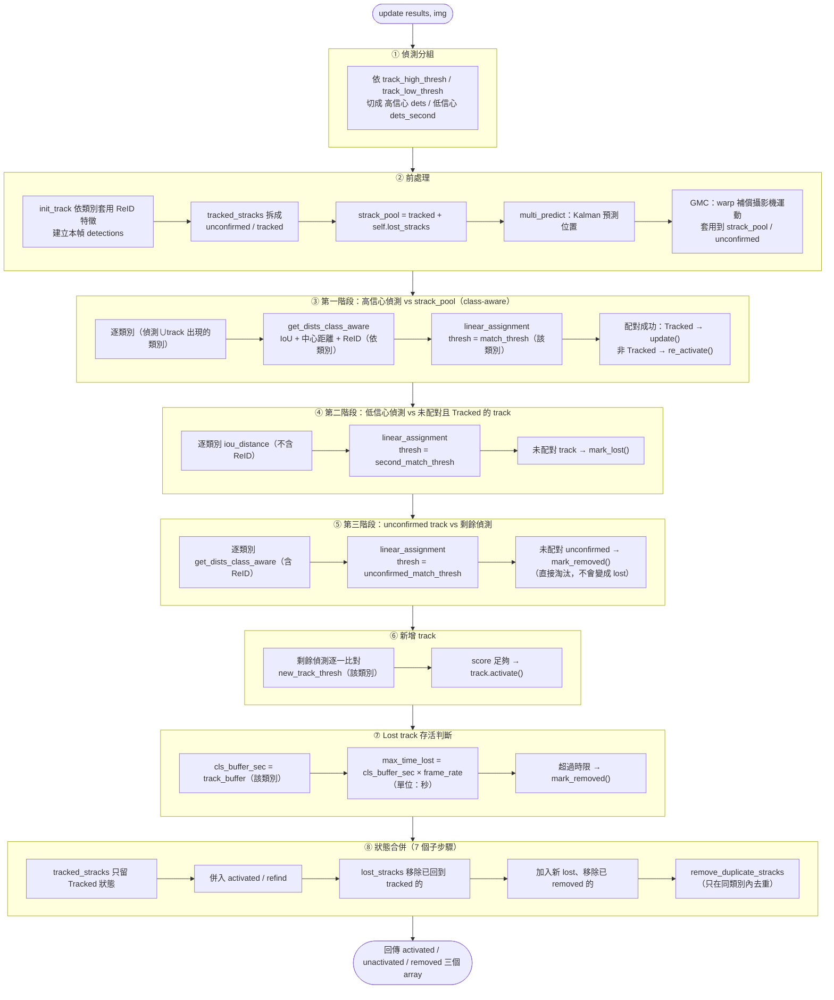

# class_aware_botsort.py 流程說明

`ClassAwareBOTSORT` 繼承 Ultralytics `BOTSORT`，override `__init__`、`init_track`、`update`、`get_dists`（改名 `get_dists_class_aware`）、`remove_duplicate_stracks`。核心邏輯與原版的對照見 `HANDOFF.md`；本檔案專注在「一次 `update()` 呼叫內部實際怎麼跑」的逐步流程。

## 一、`__init__(args, frame_rate=30)`

1. 呼叫 `super().__init__()`，沿用 BOTSORT 原生初始化（Kalman filter、`proximity_thresh`/`appearance_thresh` 等全域參數）。
2. **Kalman filter 依 fps 重新縮放**：原版 Kalman 轉移矩陣的速度項係數預設對應 30fps（`dt=1`）。若實際 `frame_rate` 不是 30，計算 `dt_scale = 30.0 / frame_rate`，把 `kf._motion_mat` 對角線上代表速度的 4 個係數（`(0,4) (1,5) (2,6) (3,7)`）乘上 `dt_scale`。frame_rate 越低，每幀間隔時間越長，同樣像素位移對應的「每幀速度」應該放大，否則 Kalman 預測位置會落後實際物體。
3. 建 `self.gmc = GMC(method=args.gmc_method)`（BoTSORT 專屬，ByteTrack 沒有這行）。
4. **逐類別建立 ReID encoder**（`self.cls_encoder: dict[cls_id, encoder|None]`）：對每個 `CLASS_TRACKING_PARAMS` 裡的類別查 `use_reid`，若為 `True` 才建立對應 encoder，否則該類別的 `cls_encoder[cls_id] = None`。依 `model` 路徑字串判斷用哪個 encoder 類別（見 `safetrajai/reid/encoders.py`）：
   - 路徑含 `reid_model_weights` → `SOTA_ReID`
   - 路徑含 `class_reid_weights` → `Custom_ReID`
   - 其餘 → `ReID`（YOLO 本身當 encoder）

## 二、`init_track(dets, scores, cls, img=None)`

把 YOLO 偵測框轉成 `BOTrack` 物件列表。**逐一偵測**檢查該偵測所屬類別是否 `use_reid=True` 且有設定 `model`：
- 是 → 用該類別的 `cls_encoder[cls_id]` 對這個偵測框 crop 出的影像算特徵向量 `f`，建立 `BOTrack(xyxy, s, c, f)`（帶特徵）。
- 否 → `BOTrack(xyxy, s, c)`（不帶特徵，之後 `get_dists_class_aware` 就不會對這個 track 做外觀比對）。

⚠️ 這裡是**逐偵測**查 `use_reid`（用該偵測的 class），不是一次整批查，所以同一幀裡不同類別的偵測可以有的帶特徵、有的不帶。

## 三、`update(results, img=None)` 逐幀主流程

模組化流程圖（每個 `subgraph` 對應 `update()` 裡的一個邏輯區塊）：

## 四、`get_dists_class_aware(tracks, detections, cls_id)` — 距離矩陣怎麼算

依 `cls_id` 查表取得該類別參數，依序疊加：

1. **基礎 IoU 距離**：`matching.iou_distance(tracks, detections)`（cost = 1 − IoU）。
2. **proximity gating**：`dists_mask = dists > (1 - proximity_thresh)`，先記下哪些 pair 距離太遠（之後若有 ReID 會直接排除，不管外觀多像）。
3. **中心點距離融合**（`center_dist_weight > 0` 才啟用）：算正規化中心點歐式距離 `_center_distance()`，跟 IoU 距離做線性加權 `(1-w)*iou + w*center`。
4. **`fuse_score`**（設定為 `True` 才啟用）：把偵測的信心分數揉進距離矩陣，讓低信心偵測的配對成本變高。
5. **ReID 外觀比對**（`use_reid=True` 且該類別有 encoder 才啟用）：
   - `emb_dists = embedding_distance(tracks, detections) / 2.0`
   - 超過 `appearance_thresh` 的 pair 設為 1.0（無法匹配）
   - 步驟 2 記下「距離太遠」的 pair 也強制設為 1.0
   - `dists = np.minimum(dists, emb_dists)`：兩個距離取更小值（IoU 夠近 **或** 外觀夠像，其一即可配對）

## 五、與 `class_aware_bytetrack.py` 的差異

| 項目 | BoTSORT | ByteTrack |
|---|---|---|
| GMC（攝影機運動補償） | 有（`self.gmc.apply()`） | 無，BYTETracker 本身不支援 |
| ReID 外觀比對 | 有（`init_track` 依類別建特徵、`get_dists_class_aware` 依類別融合 embedding） | 無，`get_dists_class_aware` 只有 IoU + 中心距離 + fuse_score |
| Kalman dt_scale 重新校正 | 有（`__init__` 手動改 `kf._motion_mat`） | 無 |
| `init_track` 簽章 | `init_track(dets, scores, cls, img=None)`，需要 `img` 來裁切算 ReID 特徵 | 沿用 BYTETracker 原生 `init_track`，不需要 `img` |
| **`track_buffer` 的單位換算**（見下方「注意事項」） | `cls_max_time_lost = cls_buffer_sec * frame_rate`（視為**秒**） | `cls_max_time_lost = (frame_rate/30.0) * cls_buffer`（視為**30fps 基準下的幀數**） |

## 六、⚠️ 注意事項：`track_buffer` 兩個 tracker 的單位不一致

`class_aware_botsort.py` 的程式碼註解明確寫「新版：cls_buffer 單位是秒，直接乘以 frame_rate 換算成幀數」，但 `class_aware_bytetrack.py` 仍是**沿用 HANDOFF.md 描述的舊公式**（`frame_rate/30 × track_buffer`，把 `track_buffer` 當作「30fps 下的幀數基準」再依實際 fps 等比例縮放）。

這代表**同一個 `track_buffer` 設定值，在兩個 tracker 下的實際存活時間差非常多**。以 `frame_rate=30` 為例：

- `track_buffer: 2.0` 在 BoTSORT → `2.0 × 30 = 60` 幀（2 秒）
- `track_buffer: 2.0` 在 ByteTrack → `(30/30) × 2.0 = 2` 幀（約 0.07 秒）

`safetrajai/tracking/track_config.yaml`（base 版）裡每個類別都設了 `track_buffer: 2.0`～`3.0`（原本是給 BoTSORT 用的設計值），如果直接拿去跑 ByteTrack，lost track 幾乎立即被清除，等同完全沒有 buffer——**這不是本次重組造成的問題，是既有程式碼的既有落差**，切換 tracker 類型或共用 track_config 檔案時要特別注意，換算前務必先確認是哪個 tracker 在讀這個值。已記錄進 `NEED.md`。
