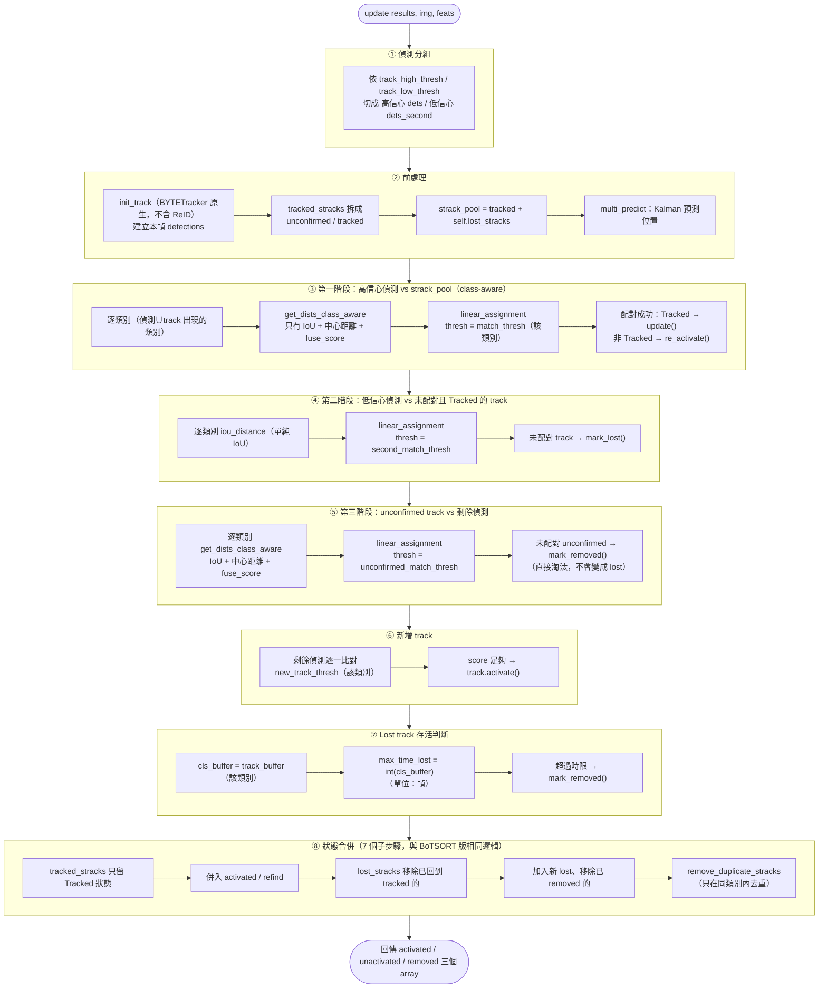

# class_aware_bytetrack.py 流程說明

`ClassAwareBYTETracker` 繼承 Ultralytics `BYTETracker`，override `__init__`、`update`、`get_dists`（改名 `get_dists_class_aware`）、`remove_duplicate_stracks`。**不 override `init_track`**——直接沿用 `BYTETracker` 原生版本，因為 ByteTrack 不需要 ReID 特徵，`init_track` 不用額外處理 `img`。與 BoTSORT 版的完整對照見 `class_aware_botsort_flow.md` 第五節；核心原理對照見 `HANDOFF.md`。

## 一、`__init__(args, frame_rate=30)`

只做一件事：呼叫 `super().__init__()` 後多存一個 `self.frame_rate = frame_rate`，保留原初始化行為；`update()` 的保留期限已直接使用幀數，不再使用此值換算。**沒有** BoTSORT 版的 Kalman dt_scale 重新校正、沒有 GMC、沒有逐類別 ReID encoder 建立。

## 二、`update(results, img=None, feats=None)` 逐幀主流程

`img`、`feats` 兩個參數都保留在簽章上（維持與 BoTSORT 版呼叫端相容），但**完全沒被使用**——ByteTrack 不用影像做外觀比對，也沒有 GMC 需要用到 `img`。

模組化流程圖（每個 `subgraph` 對應 `update()` 裡的一個邏輯區塊；跟 `class_aware_botsort_flow.md` 對照可以直接看出少了哪些區塊）：

跟 `class_aware_botsort_flow.md` 的圖對照，少了「GMC 運動補償」這個前處理步驟，第一、三階段的 `get_dists_class_aware` 也少了 ReID 那一段。

## 三、`get_dists_class_aware(tracks, detections, cls_id)` — 距離矩陣怎麼算

比 BoTSORT 版單純很多，依 `cls_id` 查表後只做：

1. **基礎 IoU 距離**：`matching.iou_distance(tracks, detections)`。
2. **中心點距離融合**（`center_dist_weight > 0` 才啛用）：`_center_distance()` 算正規化中心點歐式距離，跟 IoU 距離線性加權。
3. **`fuse_score`**（`True` 才啟用）：把偵測信心分數揉進距離矩陣。

**沒有** `proximity_thresh` gating、**沒有** ReID embedding 融合這兩步——`proximity_thresh` 這個欄位即使在 track_config 裡有設定，對 ByteTrack 也完全不起作用（只有 BoTSORT 的 `get_dists_class_aware` 會讀它）。

## 四、⚠️ 注意事項

1. **與 BoTSORT 共用同一份 `track_config*.yaml` 時，`use_reid`/`model`/`appearance_thresh`/`proximity_thresh` 這幾個欄位對 ByteTrack 完全是死欄位**（讀不到，也不會報錯，靜默忽略）。這是 ByteTrack 本身設計上不支援 ReID 的必然結果，不是 bug，但容易誤以為調整這些參數對 ByteTrack 有效。
2. **`track_buffer` 與 BoTSORT 統一為正整數幀數**（ADR 0009）：保留期限直接為 `int(cls_buffer)`，不依影片幀率換算。設定載入時檢查每個已宣告類別，沒有類別設定才使用預設參數；缺少或不是正整數時報錯。凍結方法只有這個敘述與 BoTSORT 對應敘述開放修改，其餘包含 `__init__` 與舊註解都維持原文。
